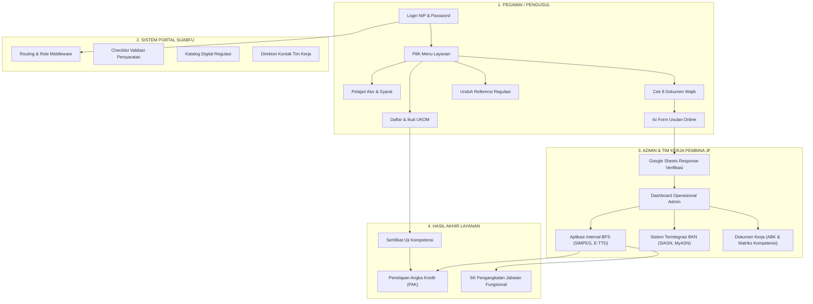
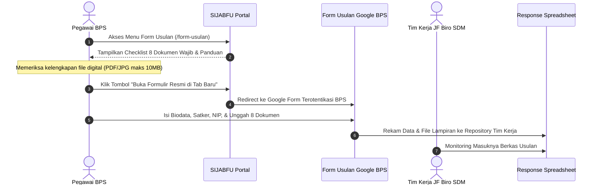
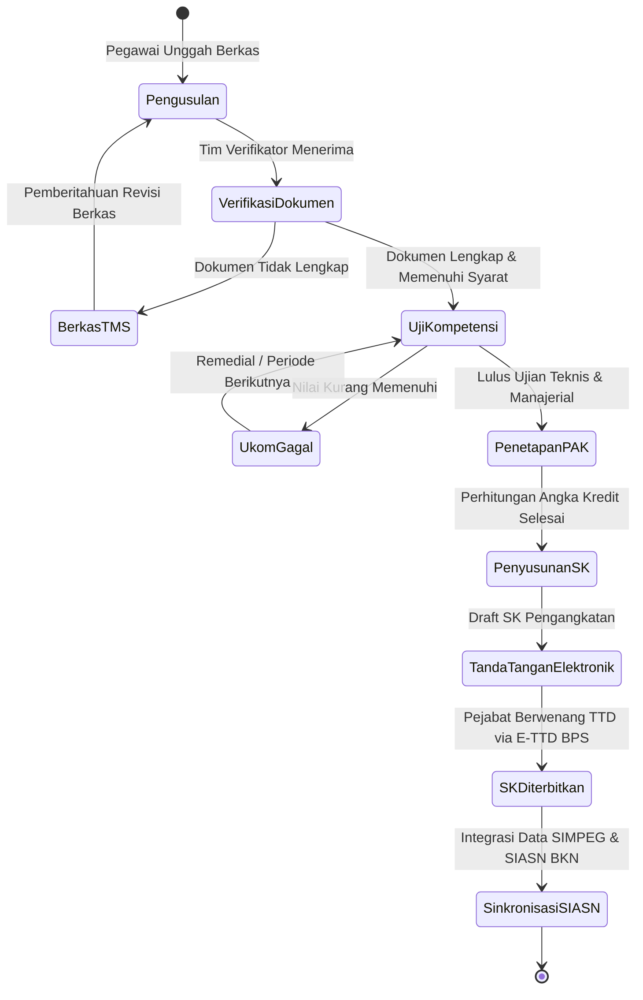

# DOKUMENTASI PROSES BISNIS SISTEM INFORMASI PEMBINAAN JABATAN FUNGSIONAL (SIJABFU)
**Badan Pusat Statistik Republik Indonesia (BPS RI)**  
*Biro Sumber Daya Manusia — Tim Pembinaan JF*

---

## 1. PENDAHULUAN & GAMBARAN UMUM SISTEM

### 1.1 Latar Belakang
Pengelolaan Jabatan Fungsional (JF) di lingkungan Badan Pusat Statistik Republik Indonesia—khususnya Jabatan Fungsional Statistisi dan Pranata Komputer—melibatkan berbagai satuan kerja (satker) di tingkat Pusat, BPS Provinsi, hingga BPS Kabupaten/Kota di seluruh Indonesia.

Sebelum adanya sistem terpusat, proses pembinaan dan pengusulan JF menghadapi beberapa kendala:
1. **Informasi Tersebar**: Regulasi, syarat usulan, dan jadwal uji kompetensi tersebar di berbagai nota dinas dan surat edaran.
2. **Tingginya Berkas Tidak Memenuhi Syarat (TMS)**: Pengusul sering kali mengunggah berkas yang belum lengkap karena kurangnya panduan checklist terstandarisasi.
3. **Keterbatasan Visibilitas Alur**: Pegawai kesulitan melacak tahapan karir fungsional mulai dari pengusulan awal, verifikasi, uji kompetensi, hingga penerbitan SK.
4. **Fragmentasi Layanan**: Tim Kerja Pembina di Biro SDM harus mengelola berbagai instrumen terpisah (aplikasi kepegawaian BPS, platform BKN, spreadsheet respons, dan dokumen legal).

### 1.2 Tujuan Aplikasi SIJABFU
Aplikasi **SIJABFU** (*Sistem Informasi & SIGMA JF*) dibangun sebagai pintu gerbang terpadu (*single entry portal*) untuk:
- Memberikan transparansi alur pengusulan dan kenaikan jenjang Jabatan Fungsional.
- Menstandarisasi persyaratan administrasi berkas pengusulan (Checklist 8 Dokumen Wajib).
- Mengintegrasikan proses pengajuan digital secara cepat, aman, dan tanpa hambatan autentikasi akun kedinasan BPS.
- Menyediakan katalog regulasi kedinasan terkini (BPS, KemenPAN-RB, BKN) yang dapat dicari secara *real-time*.
- Menyediakan *control hub* bagi Admin / Tim Kerja Pembina JF untuk mengorkestrasi tautan internal, eksternal, dan dokumen kerja penetapan formasi.

---

## 2. AKTOR DAN MATRIKS HAK AKSES (STAKEHOLDER & RACI)

### 2.1 Identifikasi Aktor

| Aktor | Peran & Deskripsi | Hak Akses Sistem |
| :--- | :--- | :--- |
| **Pegawai ASN BPS (Pengusul)** | Pegawai Negeri Sipil di lingkungan BPS RI yang ingin diangkat pertama kali, berpindah jalur, inpassing, atau naik jenjang JF. | Mengakses Portal Layanan (`/`), mempelajari Alur Layanan, memeriksa checklist dokumen, mengisi Form Usulan, memantau info Uji Kompetensi, mengunduh Regulasi, serta menghubungi Tim Pembina. |
| **Pimpinan Satuan Kerja (Satker)** | Kepala BPS Satker / Pejabat Penilai Kinerja yang menerbitkan SKP dan Surat Rekomendasi Pengusulan. | Entitas verifikator tingkat pertama (di luar sistem aplikasi/penerbit dokumen fisik). |
| **Admin Tim Kerja / PIC (Biro SDM)** | Tim Pembinaan JF Biro SDM BPS RI yang bertugas memverifikasi, menguji kelayakan, dan memproses penetapan. | Mengakses Dashboard Admin (`/admin`), mengakses database respons usulan, mengevaluasi berkas, mengelola link instrumen internal BPS, SIASN BKN, dan template penetapan. |
| **Pejabat Pembina Kepegawaian (PPK / PyB)** | Kepala BPS RI atau Pejabat yang Berwenang yang menetapkan PAK dan menandatangani SK Pengangkatan melalui E-TTD. | Penandatangan akhir SK dan PAK (diintegrasikan melalui sistem E-TTD BPS). |

### 2.2 Matriks Tanggung Jawab (RACI Matrix)

| Aktivitas Proses Bisnis | Pegawai (Pengusul) | Pimpinan Satker | Admin Tim Kerja JF | PPK / Biro SDM |
| :--- | :---: | :---: | :---: | :---: |
| Penyiapan Dokumen Persyaratan | **R** / **A** | **C** | **I** | **I** |
| Penerbitan Surat Rekomendasi Satker | **I** | **R** / **A** | **I** | **I** |
| Pengisian Formulir Usulan Online | **R** / **A** | **I** | **I** | **I** |
| Verifikasi Keabsahan & Kelengkapan Berkas | **I** | **I** | **R** / **A** | **I** |
| Pelaksanaan & Penilaian Uji Kompetensi | **R** (Peserta) | **I** | **R** (Penyelenggara) | **A** |
| Penetapan Angka Kredit (PAK) | **I** | **I** | **R** | **A** |
| Penerbitan SK Pengangkatan JF via E-TTD | **I** | **I** | **C** | **R** / **A** |
| Pengarsipan & Sinkronisasi SIASN BKN | **I** | **I** | **R** | **A** |

> *Keterangan: **R** = Responsible (Pelaksana), **A** = Accountable (Penanggung Jawab), **C** = Consulted (Konsultasi), **I** = Informed (Menerima Informasi).*

---

## 3. ARSITEKTUR PROSES BISNIS MAKRO (LEVEL 0 & LEVEL 1)



---

## 4. DEKOMPOSISI PROSES BISNIS MIKRO (LEVEL 2)

### 4.1 Proses 1: Autentikasi dan Manajemen Hak Akses
1. **Input Identitas**: Pegawai atau Admin memasukkan Nomor Induk Pegawai (NIP) dan Kata Sandi pada halaman `/login`.
2. **Validasi & Verifikasi Kredensial**:
   - Sistem memvalidasi kesesuaian format NIP dan Password melalui [AuthController.php](file:///d:/career/Sijabfu/sijabfu/app/Http/Controllers/AuthController.php).
   - Melindungi sesi dengan mekanisme proteksi CSRF dan regenerasi session token.
3. **Penyortiran Peran (*Role Routing*)**:
   - Jika `role === 'admin'`: dialihkan secara otomatis ke Dashboard Admin ([AdminController.php](file:///d:/career/Sijabfu/sijabfu/app/Http/Controllers/AdminController.php) / `/admin`).
   - Jika `role === 'pegawai'`: dialihkan ke Portal Layanan Utama ([PortalController.php](file:///d:/career/Sijabfu/sijabfu/app/Http/Controllers/PortalController.php) / `/`).
4. **Proteksi Otorisasi**:
   - Rute Admin dilindungi oleh [RoleMiddleware.php](file:///d:/career/Sijabfu/sijabfu/app/Http/Middleware/RoleMiddleware.php). Jika pegawai biasa mencoba mengakses `/admin`, sistem otomatis menolak akses dan mengembalikan pengguna ke halaman beranda dengan pesan peringatan.

---

### 4.2 Proses 2: Alur Layanan Pembinaan JF (4 Jalur Pengangkatan)
Aplikasi memfasilitasi 4 jalur mekanisme pengangkatan Jabatan Fungsional sesuai regulasi MenPAN-RB:

1. **Jalur Pengangkatan Pertama**:
   - Ditujukan bagi CPNS formasi Jabatan Fungsional (Statistisi atau Pranata Komputer).
   - Dilakukan setelah PNS menyelesaikan Pelatihan Dasar (Latsar) CPNS dan memiliki masa kerja minimal 1 tahun.
2. **Jalur Perpindahan dari Jabatan Lain**:
   - Ditujukan bagi ASN dari jabatan pelaksana atau struktural yang ingin berpindah jalur ke JF.
   - Wajib memenuhi syarat kesesuaian kualifikasi pendidikan, batas usia pensiun (BUP), serta lulus Uji Kompetensi Perpindahan.
3. **Jalur Penyesuaian (Inpassing)**:
   - Diberlakukan pada periode penataan birokrasi atau kebijakan khusus penyetaraan jabatan pemerintah.
4. **Jalur Promosi & Kenaikan Jenjang**:
   - Ditujukan bagi Pejabat Fungsional aktif yang telah memenuhi Angka Kredit Kumulatif minimal dan lulus Uji Kompetensi Kenaikan Jenjang (misal: Ahli Pertama ke Ahli Muda, atau Terampil ke Mahir).

---

### 4.3 Proses 3: Penyiapan Berkas & Pengusulan Online (Form Usulan)



#### Standarisasi 8 Dokumen Persyaratan Wajib
Sebelum membuka form usulan, sistem memandu pegawai untuk melengkapi 8 dokumen digital:
1. **Fotokopi SK CPNS / PNS** terlegalisir.
2. **Ijazah dan Transkrip Nilai** terlegalisir (minimal D-IV / S1 sesuai kualifikasi).
3. **Penilaian Kinerja Pegawai (SKP)** 2 tahun terakhir dengan predikat minimal "Baik".
4. **Fotokopi KTP / Kartu Identitas Pegawai BPS**.
5. **Surat Rekomendasi Pimpinan Unit Kerja** (Kepala Satker BPS setempat).
6. **Sertifikat Pelatihan JF Relevan** (Diklat Fungsional Terkait).
7. **Pas Foto Formal Terbaru** ukuran 4x6 latar belakang warna merah.
8. **DUPAK / Bukti Capaian Angka Kredit Terakhir**.

> **Keunggulan Arsitektur**: Integrasi form menggunakan CTA tombol pembuka tab baru ke formulir resmi Google Workspace BPS RI. Hal ini memastikan proses upload dokumen tidak terblokir oleh batasan *third-party cookie* di dalam peramban, serta menjamin berkas terunggah langsung ke penyimpanan akun kedinasan BPS yang aman.

---

### 4.4 Proses 4: Siklus Uji Kompetensi (UKOM)

Uji Kompetensi merupakan prasyarat mutlak untuk pengangkatan perpindahan dan kenaikan jenjang. Modul ini menyajikan panduan terstruktur:

1. **Tahap 1 — Pendaftaran & Seleksi Berkas**:
   - Verifikasi administratif oleh Tim Kerja Pembina atas portofolio dan rekomendasi.
2. **Tahap 2 — Uji Kompetensi Teknis**:
   - Pelaksanaan ujian berbasis *Computer Assisted Test* (CAT) atau ujian praktik analisis statistik / rekayasa komputasi.
3. **Tahap 3 — Uji Kompetensi Manajerial & Sosial Kultural**:
   - Evaluasi kompetensi perilaku, kepemimpinan, integritas, dan komunikasi kerja melalui wawancara atau metode *Assessment Center*.
4. **Tahap 4 — Pengumuman Kelulusan & Penerbitan Sertifikat**:
   - Nilai kelulusan diterbitkan secara resmi melalui sistem `kompetensi.web.bps.go.id`. Peserta yang dinyatakan lulus berhak melangkah ke penetapan PAK dan SK.

---

### 4.5 Proses 5: Penetapan PAK & Penerbitan SK Pengangkatan



1. **Perhitungan Angka Kredit (PAK)**:
   - Tim Penilai mengonversi kinerja dan portofolio pegawai menjadi Penetapan Angka Kredit resmi.
2. **Penerbitan SK Pengangkatan**:
   - Dokumen SK disusun oleh Biro SDM BPS RI.
   - Penandatanganan dilakukan menggunakan sertifikat digital tersertifikasi melalui **E-TTD BPS**.
3. **Integrasi Data Kepegawaian**:
   - Riwayat jabatan baru dimutakhirkan ke dalam **SIMPEG BPS** dan disinkronkan ke pangkalan data nasional **SIASN BKN**.

---

### 4.6 Proses 6: Manajemen Regulasi & Basis Pengetahuan (*Knowledge Hub*)

Modul Regulasi (`/regulasi`) berfungsi sebagai pangkalan data kebijakan:
- **Kategori Peraturan**:
  1. *Peraturan Kepala BPS*: Petunjuk teknis operasional JF Statistisi, standar kompetensi internal.
  2. *Peraturan Menteri PAN-RB*: Payung hukum tata kelola JF nasional (PermenPAN-RB No. 13/2019, PermenPAN-RB No. 1/2023).
  3. *Peraturan Badan Kepegawaian Negara (BKN)*: Standar teknis uji kompetensi dan angka kredit integrasi.
- **Fitur Pengguna**:
  - Filter interaktif berbasis kategori.
  - Fitur pencarian instan (*live keyword search*) tanpa *reload* halaman, mempercepat penemuan nomor atau subjek peraturan bagi ASN satker daerah.

---

### 4.7 Proses 7: Ekosistem Kerja Admin (Dashboard Pembinaan JF)

Dashboard Admin (`/admin`) merupakan sentra operasional terpadu yang memadukan 3 klaster ekosistem kerja:

```
┌────────────────────────────────────────────────────────────────────────┐
│                      DASHBOARD ADMIN BIRO SDM BPS                     │
├──────────────────┬──────────────────────┬──────────────────────────────┤
│ 🌐 LINK INTERNAL │ 🌐 LINK EKSTERNAL   │ 🌐 DOKUMEN & LAINNYA         │
│ (Ekosistem BPS)  │ (Ekosistem Nasional) │ (Alat Kerja Tim Pembina)     │
├──────────────────┼──────────────────────┼──────────────────────────────┤
│ • E-TTD BPS      │ • SIASN BKN          │ • Template Surat Usulan      │
│ • SIMPEG BPS     │ • Portal Utama BKN   │ • Peraturan JF Terkini       │
│ • Portal SDM     │ • MyASN Pegawai      │ • Berkas Penetapan JF        │
│ • E-Kinerja BPS  │ • KemenPAN-RB        │ • Rekomendasi Formasi        │
│ • Intranet BPS   │ • JDIHN Nasional     │ • Analisis Beban Kerja (ABK) │
│ • Web Utama BPS  │ • Pusbin JF BKN      │ • Matriks Standar Kompetensi │
├──────────────────┴──────────────────────┴──────────────────────────────┤
│ 📢 AKSES CEPAT (BOTTOM BAR):                                          │
│ [FORM USULAN] ─── Akses formulir Google Forms aktif                   │
│ [RESPONSE]    ─── Akses Google Sheets database respons usulan masuk    │
└────────────────────────────────────────────────────────────────────────┘
```

1. **Klaster Internal BPS (Nuansa Biru)**:
   - Akses cepat ke sistem manajemen tanda tangan elektronik (`ettd.bps.go.id`), sistem riwayat pegawai (`simpeg.bps.go.id`), portal layanan biro SDM, dan evaluasi capaian pegawai bulanan (`kinerja.bps.go.id`).
2. **Klaster Eksternal Nasional (Nuansa Hijau)**:
   - Sinkronisasi data ke instansi pembina pusat melalui SIASN BKN, MyASN, Pusbin BKN, dan KemenPAN-RB.
3. **Klaster Dokumen Kerja (Nuansa Oranye)**:
   - Standarisasi format surat pengantar, template rekomendasi, kalkulator Analisis Beban Kerja (ABK), dan tabel matriks jenjang kompetensi.
4. **Bilah Akses Cepat (*Fast-Action Bar*)**:
   - Membuka formulir pengusulan dan spreadsheet tabulasi jawaban untuk verifikasi berkas secara instan.

---

## 5. STRUKTUR MENU & PEMETAAN SISTEM

| URL Rute | Penamaan Rute | Controller & Method | Middleware | Deskripsi Fungsi |
| :--- | :--- | :--- | :--- | :--- |
| `/login` | `login` | `AuthController@showLoginForm` | `guest` | Autentikasi NIP & Password |
| `/login` [POST] | - | `AuthController@login` | `guest` | Validasi kredensial pengguna |
| `/logout` [POST] | `logout` | `AuthController@logout` | `auth` | Mengakhiri sesi pengguna |
| `/` | `home` | `PortalController@index` | `auth` | Halaman utama portal layanan pegawai |
| `/alur-layanan` | `alur-layanan` | `PortalController@alurLayanan` | `auth` | Panduan tahapan dan 5 langkah layanan |
| `/form-usulan` | `form-usulan` | `PortalController@formUsulan` | `auth` | Checklist 8 berkas dan link form usulan |
| `/uji-kompetensi` | `uji-kompetensi` | `PortalController@ujiKompetensi` | `auth` | Informasi tahapan, syarat, dan jadwal UKOM |
| `/regulasi` | `regulasi` | `PortalController@regulasi` | `auth` | Repositori dan live search regulasi JF |
| `/tim-kerja` | `tim-kerja` | `PortalController@timKerja` | `auth` | Profil pembina JF & kanal bantuan helpdesk |
| `/admin` | `admin.dashboard` | `AdminController@index` | `auth, role:admin` | Dashboard integrasi tautan operasional tim kerja |

---

## 6. INDIKATOR KINERJA PROSES BISNIS (KPI & MANFAAT)

Implementasi proses bisnis SIJABFU memberikan dampak terukur terhadap tata kelola kepegawaian BPS:

1. **Penurunan Tingkat Berkas Tertolak (*Zero Document Reject*)**:
   Adanya checklist 8 dokumen wajib sebelum pengisian form mencegah pengajuan berkas tidak lengkap (*incomplete submission*).
2. **Peningkatan Efisiensi Waktu Verifikasi**:
   Admin Biro SDM dapat langsung mengakses tabulasi respons tersentralisasi, memotong durasi seleksi administrasi dari hitungan minggu menjadi hitungan hari.
3. **Sentralisasi Pengetahuan Kepegawaian**:
   Seluruh ASN BPS di seluruh Indonesia memiliki akses yang setara terhadap informasi formasi, regulasi, dan jadwal uji kompetensi tanpa terhambat batas geografis.
4. **Pencegahan Kendala Teknis Pengunggahan Berkas**:
   Pengalihan pengisian berkas ke tab mandiri Google Forms resmi kedinasan BPS menyelesaikan kendala autentikasi Google Workspace di lingkungan peramban pengguna.

---

## 7. KESIMPULAN

Aplikasi **SIJABFU** mentransformasikan proses administrasi pembinaan Jabatan Fungsional BPS RI yang sebelumnya bersifat terfragmentasi menjadi ekosistem digital yang terpadu, transparan, dan profesional. Dengan pemisahan peran yang jelas antara Pegawai Pengusul dan Tim Kerja Biro SDM, sistem ini menjamin akuntabilitas karir fungsional ASN BPS dari pengusulan awal hingga terbitnya Surat Keputusan Pengangkatan.
